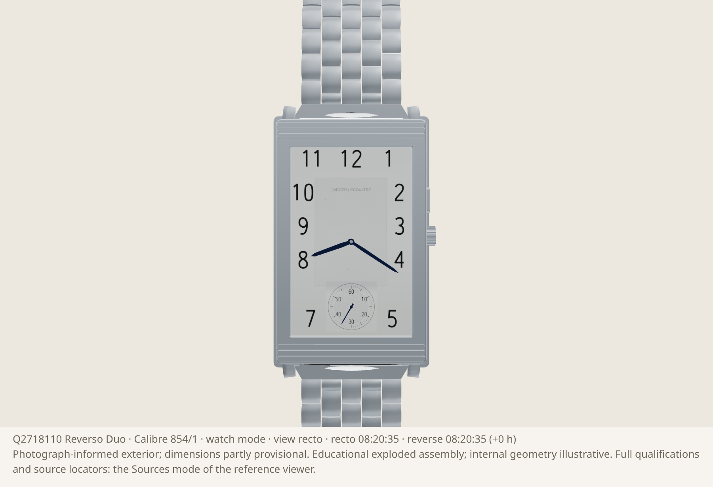

# Jaeger-LeCoultre Reverso Duo Q2718110

A personal documentation project for a newly acquired heirloom: the **Q2718110 steel-bracelet Reverso Duo / Duoface**, with its **Calibre 854/1**. This public reference pack includes a photograph-informed 3D viewer, original renders and research notes. Exterior proportions and the educational movement remain provisional, not factory CAD.

**Start with [START_HERE.md](START_HERE.md), then [the Dot brief](docs/12-dot-brief.md).**

**Public source:** [Kitkitkittt/jlc-reverso](https://github.com/Kitkitkittt/jlc-reverso). Private owner references stay local and outside repository history.

## Run the watch app

**Live app:** [jlc-reverso-q2718110.netlify.app](https://jlc-reverso-q2718110.netlify.app/model/).

```bash
npm ci
npm run serve
```

Open [http://127.0.0.1:8000/model/](http://127.0.0.1:8000/model/). No backend, accounts or external media requests are required.

- **Watch:** case-first gallery, upright front/back comparisons and a separate whole-watch view. Drag to orbit, scroll or pinch to zoom; use Flip for normal reversal.
- **Mechanism:** whole-watch explosion and close educational calibre views. Play, pause or scrub guided assembly and use previous/next stages. Run/Pause independently animates the balance, fork, escape wheel and train; only balance cadence is catalogue-derived.
- **Sources:** provenance and full accuracy limits without covering the default watch presentation. The concise educational notice stays visible in every mode.
- Select a visible part to inspect its name, role and evidence. The inspector holds time/GMT, visibility and export controls; on mobile it starts collapsed. One clock drives six hands; GMT advances only the reverse hour offset and leaves minutes linked.
- Download GLB, native Three.js JSON or a concise captioned PNG. Geometry is authored in mm; GLB applies one `0.001` meter conversion and includes four independent reversal, whole-watch explosion, calibre explosion and calibre assembly clips. Native JSON stays in the assembled rest pose.

The procedural exterior source is [model/exterior.js](model/exterior.js); editable proportions are under `PARAMETERS.illustrative`. [model/movement.js](model/movement.js) authors the detailed movement in one source file, [model/assembly.js](model/assembly.js) defines shared guided-assembly stages, and [model/behavior.js](model/behavior.js) defines clock and presentation motion. Movement geometry is original, source-inspired educational work, not traced or calibrated factory geometry.

```bash
npm run check
python3 tools/validate_pack.py
node tools/check_playback.mjs
```

The checks exercise display/motion boundaries, shared movement stages and native geometry round trips. With the local server running, the real Chromium check covers reversal and calibre assembly Play, focused/unfocused scrub holds, resume, stage navigation, completion and recto reset. Reference validation checks source records, null physical measurements and the private owner-photo policy. A public clone requires no private photographs or documents; dependencies and generated `dist/` documentation are excluded from reference scanning.

Generated assets:

| Asset | Purpose |
| --- | --- |
| [Animated GLB](exports/q2718110-reference.glb) | Assembled meter-scaled model, four independent reversal, whole-watch explosion, calibre explosion and calibre assembly clips |
| [Native Three.js scene](exports/q2718110-assembled.three.json) | Assembled mm snapshot with detailed movement, original procedural textures, evidence and assembly metadata |
| [Recto](renders/recto.png) / [reverse](renders/reverse.png) | Matched upright comparison plates |
| [Oblique](renders/oblique.png) | Photograph-informed case and bracelet profile |
| [Released](renders/released.png), [turning](renders/turning.png), [reverse seated](renders/reverse-seated.png) | Illustrative reversal sequence |
| [Exploded assembly](renders/exploded-assembly.png) | Stable-ID callouts and accuracy legend |
| [Calibre assembled](renders/calibre-assembled.png) / [calibre exploded](renders/calibre-exploded.png) | Close views of twelve educational movement groups |
| [Guided calibre assembly](renders/calibre-assembly.mp4) | Original model animation; explanatory staging, not workshop instructions or copied teardown footage |

### Publish updates

```bash
npm run build
netlify deploy --dir dist --no-build --prod --site jlc-reverso-q2718110
```

`dist/` contains only the app, required scene specification, a field-allowlisted factual source index, generated exports/renders and locally bundled Three.js. Owner photographs, private files, credentials, raw research assets and regression pages are not published. Netlify authentication and local site linkage stay outside versioned files. Keep the site's toolbar and promotional badge disabled: their injected HUD previously caused a blocking resize error. Application errors are still reported normally. The app has no backend or runtime CDN dependency.

The gallery appearance pass improves close framing, studio reflections, case-end relief, five-column bracelet articulation, original Arabic numeral paths, blue-black hands, dial finish and educational movement depth. Surface and profile choices remain editable artistic approximations; they do not establish exact dimensions, factory typography or calibrated movement geometry.


## The watch this pack follows



The owner's actual wrist photograph establishes the exterior target but is retained privately and omitted from this public repository. Public images are renders of the original procedural model, not altered owner photographs. Acquisition documents, serial numbers, certificates, contacts and credentials are not published.

- Recto: silver dial, black Arabic numerals, blue hands and circular small seconds near 6.
- Recto controls: crown on the right; rectangular GMT pusher **above the crown**, toward 12.
- Reverse: dark dial, upper circular hour/minute display and lower 24-hour indicator.
- Reverse controls: the same crown and pusher appear on the **left** when that dial faces the viewer.
- The watch uses one manually wound movement for both displays.

## Core reference data

| Field | Value | Evidence scope |
| --- | --- | --- |
| Commercial reference | Q2718110; catalogue format 271 81 10 | Manufacturer catalogue |
| Family | Reverso Duo / Duoface | Manufacturer catalogue |
| Case material | Stainless steel | Manufacturer catalogue |
| Catalogue case size | 42.2 × 26 mm | Manufacturer catalogue; dimensions are not a complete CAD drawing |
| Movement | Calibre 854/1 | Historical manufacturer's Reverso Duo entry |
| Movement components | 180 | Manufacturer calibre specification; not the count of objects in this pack |
| Beat rate | 21,600 vibrations/hour | Manufacturer catalogue |
| Nominal power reserve | 45 hours | Manufacturer catalogue |
| Jewels | 21 | Primary auction cataloguing of the same calibre; owner's movement has not been opened |
| Reverse correction | +1 hour per pusher press | Manufacturer catalogue |
| Water resistance | 3 bar, as originally specified | Manufacturer catalogue; not a present-condition pressure-test result |

Sources and limitations: [source register](references/source-register.md), [specification record](data/specifications.json).

**Do not substitute a current Reverso Tribute.** Its dial, hidden slider, case size and current Calibre 854 specifications are different. A current 42-hour specification is not the historical 854/1's 45-hour specification.

## Documentation

| File | Purpose |
| --- | --- |
| [01-watch-reference](docs/01-watch-reference.md) | Identity, historical reference, specifications and variant boundaries |
| [02-owner-photo-observations](docs/02-owner-photo-observations.md) | Features actually visible in the supplied photographs |
| [03-dials-and-exterior](docs/03-dials-and-exterior.md) | Recto, reverse, controls, bracelet and visual matching |
| [04-case-and-reversal](docs/04-case-and-reversal.md) | Cradle, moving case, slide and reversal animation |
| [05-calibre-854-1](docs/05-calibre-854-1.md) | Movement functions, subsystem explanation and limits |
| [06-disassembly-reference](docs/06-disassembly-reference.md) | Teardown source, frame checklist and annotation protocol |
| [07-assembly-map](docs/07-assembly-map.md) | Project component IDs, grouping and explosion planning |
| [08-geometry-and-measurements](docs/08-geometry-and-measurements.md) | Units, coordinate conventions and measurements still needed |
| [09-materials-and-rendering](docs/09-materials-and-rendering.md) | Materials, dial textures, lighting and render requirements |
| [10-controls-and-animation](docs/10-controls-and-animation.md) | Time relationships, pusher logic and case motion |
| [11-quality-checks](docs/11-quality-checks.md) | Acceptance checks that catch earlier reference errors |
| [12-dot-brief](docs/12-dot-brief.md) | Ready-to-use modeling handoff |
| [13-open-questions](docs/13-open-questions.md) | Three next evidence improvements |

## Images and machine-readable records

- [External movement image atlas](references/movement-image-atlas.md): verified source URLs, including the image identified as 854/1 and a separately labeled modern comparison.
- [Source documents](references/document-index.md): historical catalogue locators and a current manual expressly marked as a different variant.
- [Exterior schematic](assets/schematics/exterior-layout.svg): original simplified guide, subordinate to the photographs.
- [Case motion schematic](assets/schematics/case-motion.svg): original coordinate and orientation guide.
- [Display layer schematic](assets/schematics/display-layers.svg): grouping only; not a factory disassembly drawing.
- [Movement function schematic](assets/schematics/movement-functions.svg): general mechanical relationships, not measured gear placement.
- [Assembly inventory](data/assembly-inventory.csv): modeling groups, evidence and unknown geometry.
- [Scene specification](data/scene-spec.json): units, hierarchy, constraints and null physical transforms.
- [Teardown frame log](data/disassembly-frame-log.csv): reviewed S07 locators, visible observations and unresolved identification limits.
- [Claims register](data/claims.csv): supported, observed, derived and unresolved statements.

## Accuracy boundary

No authenticated factory 854/1 parts catalogue, lubrication chart or dimensioned exploded drawing was recovered during this research. [S07, the Cal.854-1 maintenance video](https://www.youtube.com/watch?v=BohN-EtjQuw), has now been visually reviewed at recorded locators. Visible JLC/SWISS markings support source context, but the exact 854/1 engraving remains unread; the title's attribution does not authenticate the owner's movement. This repository does **not** claim an exact 180-part reconstruction.

The pack supports exterior modeling, twelve detailed educational movement groups and a 12-second guided assembly presentation. Mainplate, bridges, winding, barrel, train and balance geometry are source-informed artist work; escapement/hairspring and display-transfer geometry remain general or schematic. Internal pivot coordinates, tooth counts, bores, exact bridge profiles and factory assembly order remain unresolved. Physical evidence dimensions remain null where unmeasured, and the viewer retains a visible accuracy statement. See [the calibre note](docs/05-calibre-854-1.md) and [assembly map](docs/07-assembly-map.md).

## Validation

```bash
python3 tools/validate_pack.py
```

This checks local links, source IDs, assembly references, JSON validity, missing physical dimensions and the reference-specific dial/control constraints. It does not authenticate a movement or certify a mechanical reconstruction.

## Rights

Original documentation and schematics are covered by [LICENSE.md](LICENSE.md). Owner imagery and third-party links have separate treatment in [RIGHTS.md](RIGHTS.md). Manufacturer PDFs, seller photographs and teardown footage are linked or described, not copied into the repository. Personal serial numbers and certificate details are excluded.

Research began **2026-10-12**; movement-source review updated **2026-10-13**. This is an independent reference project and is not affiliated with Jaeger-LeCoultre.
